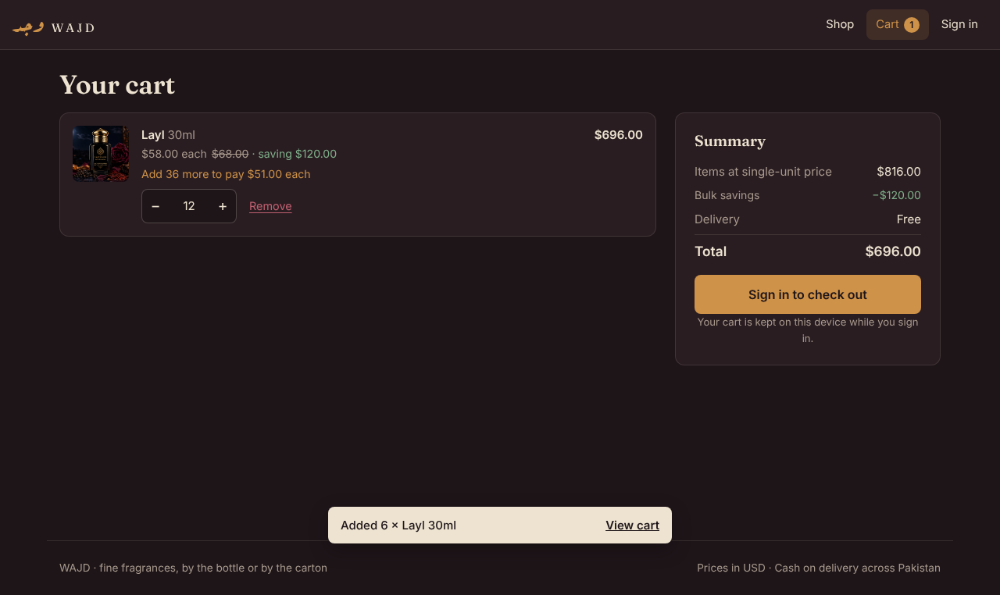
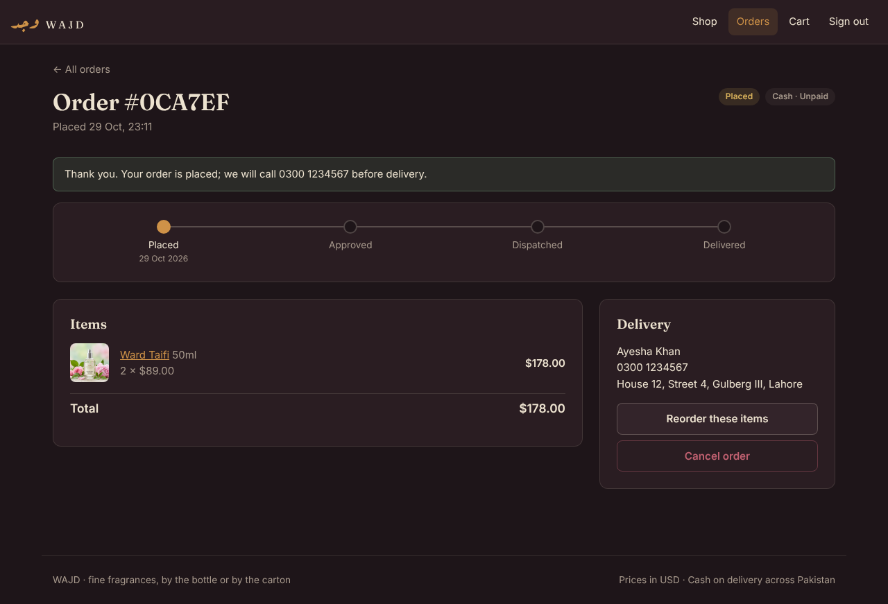
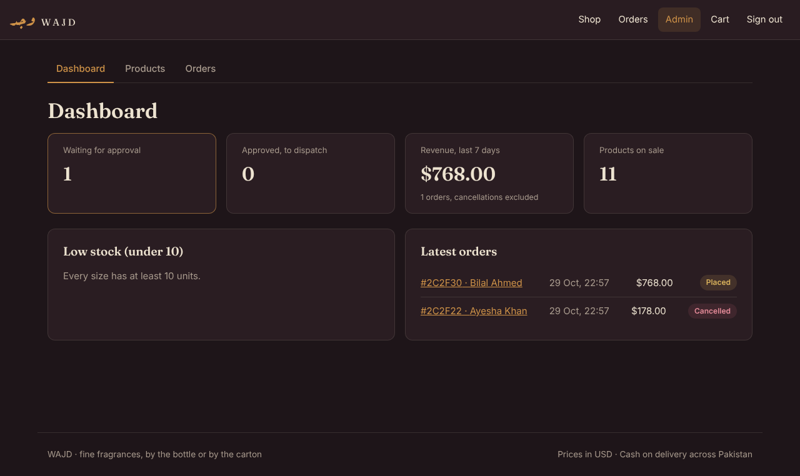
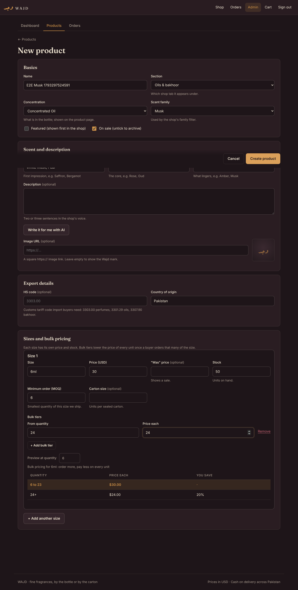
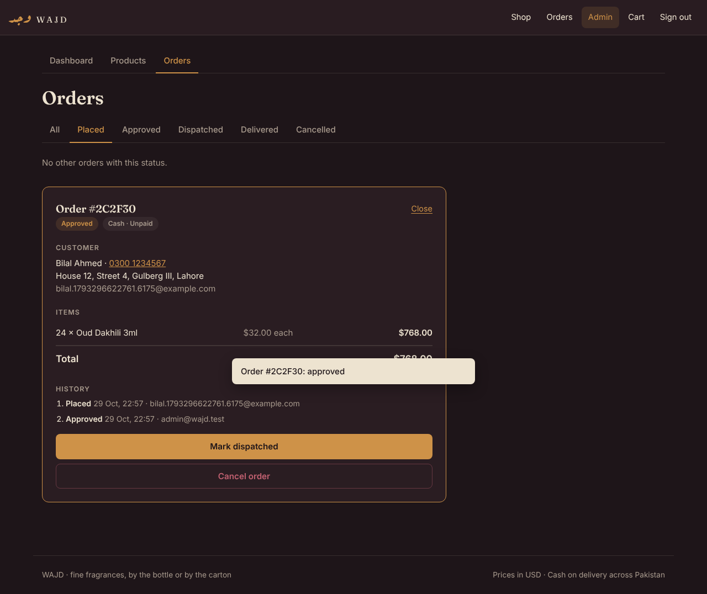

# Wajd · Fine Fragrances

**Live demo:** [wajd-fragrance-store.vercel.app](https://wajd-fragrance-store.vercel.app)
**API:** [wajd-fragrance-store.onrender.com/api/ping](https://wajd-fragrance-store.onrender.com/api/ping)

> The API runs on Render's free tier and sleeps after 15 idle minutes. The first request can take 30 to 60 seconds; the store shows a "waking up" message meanwhile. The free MongoDB Atlas cluster also pauses after 30 idle days and has to be resumed from the Atlas dashboard.

A MERN store for perfumes and concentrated oils that sells to two kinds of buyer at once: someone after a single bottle, and a reseller ordering by the carton. Bulk price tiers, minimum order quantities, carton sizes and HS codes are part of the core model, and the server prices every order itself.


## Screens (11, all routed and data-driven)

| # | Screen | Route | Who | What it is for |
|---|---|---|---|---|
| 1 | Catalog | `/` | Anyone | Search by note, filter by type and scent family, sort, page. Filters live in the URL. |
| 2 | Product | `/p/:slug` | Anyone | Pick a size and quantity; the stepper starts at the MOQ, caps at stock, shows the tier ladder and "add N more to pay X". |
| 3 | Cart | `/cart` | Anyone | One line per product and size, priced by the server, with bulk savings and per-line MOQ/stock problems. |
| 4 | Sign in / Create account | `/login` | Guest | Returns the buyer to where they were (usually checkout) with the cart intact. Password reset included. |
| 5 | Checkout | `/checkout` | Customer | Delivery details (prefilled from the last order), cash on delivery or card. |
| 6 | Order detail | `/orders/:id` | Customer | Status timeline, items at the price charged, cancel while pending, pay now, reorder. |
| 7 | My orders | `/orders` | Customer | History with status filters and reorder. |
| 8 | Dashboard | `/admin` | Admin | Orders waiting, revenue for 7 days, low-stock sizes, latest orders. |
| 9 | Products | `/admin/products` | Admin | Search, inline stock edits per size, archive and restore. |
| 10 | Product editor | `/admin/products/new`, `/:id` | Admin | Full create and edit: sizes, MOQ, cartons, bulk tiers with live preview and per-field errors, AI description. |
| 11 | Orders | `/admin/orders` | Admin | Fulfil one valid step at a time: approve, dispatch, deliver, or cancel. |

| Product | Cart | Order |
|---|---|---|
|  |  |  |

| Admin dashboard | Product editor | Admin orders |
|---|---|---|
|  |  |  |

## How the important rules work

- **Pricing is server-side.** The cart and checkout show `POST /api/orders/quote`, the same function that prices the real order. The browser never sends a price; a tampered request is ignored (tested).
- **Bulk tiers apply to the total of a size.** Adding 6 bottles and later 6 more is one line of 12 at the 12+ price. Lines are merged on the client and again on the server.
- **MOQ.** Each size has a minimum order. The product page starts there, the cart flags anything below it, and the server refuses it. A bulk tier must start above the MOQ and be cheaper than the price below it, checked in the form, in request validation and in the model.
- **Stock.** Taken with conditional atomic updates when the order is placed, so two buyers can never both get the last unit; a multi-line order that fails part-way gives back what it took. Cancelling restores stock exactly once.
- **Order lifecycle.** Pending → Approved → Dispatched → Delivered, or Cancelled from Pending/Approved. Every change is recorded with who made it. Customers can cancel only while Pending. Cash orders become Paid on delivery.
- **Card payments.** Stripe Checkout in test mode (card 4242 4242 4242 4242). The session is built from the order's server prices, and the order is marked Paid only after the server retrieves the session from Stripe and checks it is paid, for this order, for the full amount. Stripe does not onboard Pakistani merchants, so a real local launch would use a gateway such as Safepay or PayFast behind the same service.
- **Roles.** Admin is a Firebase custom claim (`npm run make-admin -- someone@example.com` in `server/`) or an email listed in `ADMIN_EMAIL`. Every admin route checks it on the server.
- **Resilience.** The API starts even if MongoDB is unreachable, retries the connection, and answers with a clear 503 meanwhile. One-time data migrations run on startup and are recorded in a `migrations` collection.

## Stack

React 18 + Vite, React Router, TanStack Query · Node.js, Express, MongoDB/Mongoose, zod, helmet, express-rate-limit · Firebase Authentication (identity only) · Stripe Checkout · Anthropic API (admin description writer) · Jest + Supertest + mongodb-memory-server · Playwright + Firebase Auth emulator.

## Running locally

```bash
npm run install:all     # server, client and root
npm run dev             # API on :5000 and store on :3000
```

Both `.env` files are needed first; see `server/.env.example` and `client/.env.example`. `npm run seed` in `server/` loads the 11-product catalog (it replaces existing products).

## Tests

```bash
npm run test:api        # 29 API tests against an in-memory MongoDB (no setup needed)
npm run test:e2e        # 7 browser tests: Auth emulator + in-memory DB + the real client
```

The end-to-end suite starts everything it needs and never touches the live database or real accounts. It needs Java 11+ for the Auth emulator and, once, `npx playwright install chromium` inside `playwright-tests/`. `SHOTS=1 npm run test:e2e` also refreshes the screenshots in `docs/screenshots`.

What the tests cover: merged-line tier pricing, MOQ refusal, price tampering, stock races and rollback, cancel restoring stock once, roles and other users' orders, every allowed and forbidden status move, card payment verification (including a wrong amount), product validation on create and edit, slugs, archive, dashboard numbers, migrations, guest-to-checkout sign-up, phone-width layout with no sideways scrolling.

## Deployment

- **Frontend:** Vercel, project root `client/`. `client/vercel.json` sets the Vite build, the `build/` output folder and the single-page-app rewrite so deep links like `/orders/123` work on refresh. The existing `REACT_APP_*` variables are read as-is.
- **API:** Render web service, root `server/`, build `npm install`, start `npm start`. `CLIENT_ORIGIN` may list several origins separated by commas.
- **Database:** MongoDB Atlas M0.
- **Firebase:** the frontend's domain must be in Authentication → Settings → Authorized domains.

## Security notes

No secrets are committed. Request bodies are validated with zod, CORS is limited to `CLIENT_ORIGIN`, security headers come from helmet, and the API, order and AI routes are rate limited per IP.
